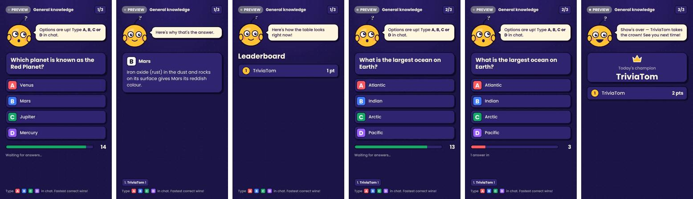
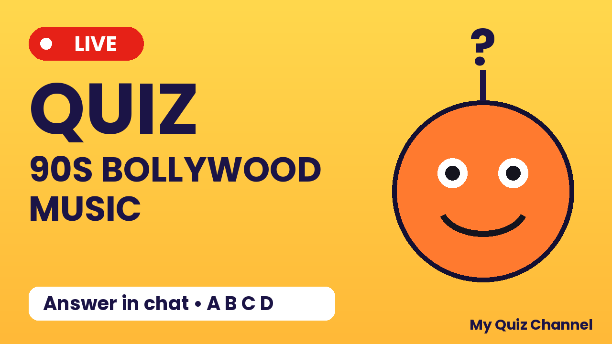

# QuizCaster

**An AI quizmaster for YouTube live streams.** QuizCaster runs a multiple-choice
quiz on your channel in **vertical 9:16 format**. Viewers answer A, B, C or D in
live chat. The first correct answer wins the question, the app shouts out the
winner on screen, and a live leaderboard tracks the scores.



[](https://github.com/Bhavana-Krishnan/quizcaster/actions/workflows/ci.yml)
[](https://github.com/Bhavana-Krishnan/quizcaster/releases/latest)
[](LICENSE)

## Why QuizCaster

- **Your computer, your keys.** Everything runs locally. There's no cloud server,
  no account and no subscription. You bring your own AI key and your own Google
  project.
- **Built for YouTube.** Streams are vertical, not made for kids (so live chat
  works), and flagged as containing AI-generated content, as YouTube asks.
- **Cheap to run.** The AI works *before* the show, writing questions and host lines.
  During a show it makes no AI calls, and chat is read only while answers are open.
- **You stay in control.** Every question is reviewed and approved before it can
  air. Stop after this question, or stop now.
- **Works from your phone.** Start, stop and watch a show from your phone on the
  same Wi-Fi. Your keys stay on the computer.

## What you need

| Item | Why | Cost |
|---|---|---|
| Windows 10/11 or Ubuntu 22.04+ | Runs the app and the video renderer | — |
| A YouTube channel with live streaming enabled | Where the show goes | Free |
| A Claude or OpenAI API key | Writes questions and host lines | Pay as you go, usually a few cents per quiz |
| A Google Cloud project (free) | Gives the app permission to use your channel | Free |
| FFmpeg | Encodes and sends the video | Free |
| Google Chrome or Microsoft Edge | Draws the on-screen overlay | Free |
| Upload speed of about 4 Mbps | Keeps the stream smooth | — |

## Install

### Windows

1. Install FFmpeg: open PowerShell and run `winget install Gyan.FFmpeg`, then open a new window.
2. Download `QuizCaster-vX.Y.Z-windows-x64.zip` from the
   [latest release](https://github.com/Bhavana-Krishnan/quizcaster/releases/latest), unzip it, and open the `QuizCaster` folder.
3. Double-click `QuizCaster.exe`. A console window shows the address, and the
   dashboard opens in your browser.

### Ubuntu

1. Install FFmpeg: `sudo apt update && sudo apt install -y ffmpeg`
2. Download `QuizCaster-vX.Y.Z-linux-x64.tar.gz` from the
   [latest release](https://github.com/Bhavana-Krishnan/quizcaster/releases/latest) and extract it:
   ```bash
   tar -xzf QuizCaster-*-linux-x64.tar.gz
   cd QuizCaster
   ./QuizCaster
   ```
3. Chrome: install it from [google.com/chrome](https://www.google.com/chrome/) if you don't have it.

### From source (developers)

```bash
git clone https://github.com/Bhavana-Krishnan/quizcaster.git
cd quizcaster
python -m venv .venv
source .venv/bin/activate              # Windows: .venv\Scripts\activate
pip install -r requirements.txt
python -m playwright install chromium
python run.py
```

## Set up once

### 1. Connect an AI model

1. Open the **Setup** tab, choose **Claude** or **OpenAI**, and paste your key.
2. Press **Verify key**. QuizCaster checks it and lists the models you can use.
3. Pick a model and press **Use this model**.

Your key is encrypted and stored only on your computer. It is never sent anywhere
except to the AI provider you chose.

### 2. Create your YouTube credentials (about 10 minutes, once)

YouTube needs your permission for the app to manage your streams. You grant that
with a free Google Cloud "OAuth client" that **you** create. This keeps your
YouTube API quota (10,000 units a day by default) separate from everyone else's.

1. Go to [console.cloud.google.com](https://console.cloud.google.com) and sign in
   with the Google account that owns your channel.
2. Create a project: top bar → project menu → **New project**. Any name works.
3. **Enable the API:** **APIs & Services → Library**, search for
   **YouTube Data API v3**, and press **Enable**.
4. **Consent screen:** **APIs & Services → OAuth consent screen**.
   - User type: **External**, then **Create**.
   - Fill in the app name (e.g. "My QuizCaster") and your email for support and contact.
   - On **Test users**, press **Add users** and add the Google account that owns your channel.
   - Save. You don't need to publish the app or get Google verification, because
     you're the only user of your own copy.
5. **Create the client:** **APIs & Services → Credentials → Create credentials →
   OAuth client ID**.
   - Application type: **Desktop app**. Name it anything.
   - Copy the **Client ID** and **Client secret**.
6. In QuizCaster, go to **Setup → YouTube**, paste both, press **Save**, and then
   **Sign in with Google**. Approve the permissions.

Your client secret is stored encrypted on your computer. Don't share it, and don't
commit it to git.

### 3. Check live streaming is enabled

Press **Check live streaming** in Setup. If your channel isn't ready, the app
tells you how to enable it. Activation can take up to 24 hours on a new channel.

## Make a quiz

Open the **Questions** tab. You have two options.

**Generate with AI.** Enter a topic (such as "Indian history", "90s Bollywood" or
"space"), choose how many questions, and press **Generate**. Questions are written
in batches, and the correct answers are spread across A to D.

**Upload your own.** Use a CSV, Excel (`.xlsx`) or JSON file with these columns:

| question | option_a | option_b | option_c | option_d | answer | explanation |
|---|---|---|---|---|---|---|
| Which planet is the Red Planet? | Venus | Mars | Jupiter | Mercury | B | Iron oxide gives Mars its colour. |

- `answer` can be `A`–`D`, `1`–`4`, or the exact text of the correct option.
- Download the template from the app, or see [`examples/sample-questions.json`](examples/sample-questions.json).

**Review before airing.** Check each answer and explanation, edit anything wrong,
then approve. AI can be confidently wrong, and only approved questions are played.

## Go live

1. In the **Go live** tab, pick the question set and a **theme**: Light, Dark or Neon.
2. Choose how to run it:
   - **Preview:** plays on your screen with pretend viewers. No YouTube quota, and optionally records an MP4. Start here.
   - **Test run:** goes live on your channel as **unlisted**, so only people with the link can see it.
   - **Go live:** the real show, public or unlisted, as you choose.
3. Check the title, description and tags. QuizCaster fills in sensible defaults and makes a thumbnail.
4. Press start. The **Live** tab shows what viewers see, the incoming comments, the leaderboard and activity.

**Finish after this question** ends the show cleanly with the final leaderboard.
**Stop now** ends it immediately.



## How a question plays

| Step | On screen | Chat |
|---|---|---|
| Question | The question alone, for 4 seconds | Not read |
| Options | Four colour-coded options and a timer (30 seconds at most) | **Read** until the first correct answer or the timer ends |
| Reveal | The correct option is highlighted, with the winner's name and a one-liner | Not read |
| Explanation | Why the answer is right | Read for 10 seconds for **"why?"**. The person who asks gets a shout-out. |
| Leaderboard | Top 5 scores | Not read |

Rules the app follows:

- An answer is a single letter, in any case (`b`, `B`, `B!`). Only each viewer's **first** answer counts.
- "First" means the earliest YouTube comment timestamp after the options appeared.
- Viewer names are checked for offensive words and links before they appear on screen.
  Add your own blocked words to `data/blocked_words.txt`, one per line.
- If nobody answers correctly, the answer is revealed with friendly filler commentary.

## Phone remote

1. On the computer: **Setup → Mobile remote → Allow my phone to connect**.
2. Restart QuizCaster once so it accepts connections from your network.
3. On your phone, open the address shown in Setup and enter the 6-digit PIN.
4. Add the page to your home screen for an app-like icon.

The phone can start a show from an approved question set, stop it, and watch the
comments and leaderboard. It **can't** see or change your keys or settings, and
wrong PINs are rate-limited. **The computer does all the streaming**, so keep it
awake and connected during a show.

## Updates

QuizCaster checks GitHub for new releases once a week and shows a banner when
one is available. It never installs updates during a show. Download the new
version from the release page, or turn checking off in **Setup → Updates**.

## Cost and quota

- **AI:** questions are generated before a show. The stream itself makes no AI
  calls, except that one short call per show writes the host's one-liners.
- **YouTube quota:** the default 10,000 units a day is plenty for several shows. A
  question uses at most about 110 units, and less when answers come in quickly. The
  Go live tab estimates how many questions today's quota allows. QuizCaster ends
  shows gracefully before the quota runs out.
- **Video:** 720×1280 at 30 frames per second, about 2.5 Mbps.

## When things go wrong

| Problem | What to do |
|---|---|
| "Live streaming isn't enabled" | Enable it in YouTube Studio → Create → Go live, then wait up to 24 hours. |
| "FFmpeg isn't installed" | Install it (see Install), then restart QuizCaster. Previews still work without it. |
| "No browser found for the video renderer" | Install Google Chrome or Microsoft Edge, then restart. |
| Google sign-in says "redirect_uri_mismatch" | Your OAuth client is the wrong type. Create a **Desktop app** client. |
| Google sign-in says "access blocked" or "app not verified" | Add your Google account under **OAuth consent screen → Test users**. |
| "YouTube never received the video" | Check your upload speed, and that outgoing port 1935 (RTMP) isn't blocked. |
| Thumbnail not set | Custom thumbnails need a verified channel (youtube.com/verify). The stream still runs. |
| The show shows a technical break | Chat or the video encoder had a problem. QuizCaster retries and resumes automatically. Check **Activity** in the Live tab. |

Found something else? [Open an issue](https://github.com/Bhavana-Krishnan/quizcaster/issues) and include the Activity log.

## Your data

Everything is stored in your user folder: `~/QuizCaster/data` in the packaged app,
or `data/` next to the source code.

- `quizcaster.db` stores settings, questions, history and the quota ledger.
- `secret.key` encrypts your API key, Google client secret and sign-in tokens.
  **Don't share it.** Without it, the stored keys can't be read.
- `thumbnails/` and `recordings/` hold generated thumbnails and preview recordings.

To start fresh, quit QuizCaster and delete that folder.

## Security

- Keys and tokens are encrypted at rest with Fernet (AES-128, with an HMAC).
- The dashboard listens only on your own computer. The phone remote is off by default and needs a PIN.
- Secrets are scanned on every push by [gitleaks](https://github.com/gitleaks/gitleaks).
- To report a vulnerability, please open a private security advisory on the repository rather than a public issue.

## Developing

```bash
pip install -r requirements.txt pytest
python -m playwright install chromium
python -m pytest -q
```

The tests cover answer parsing, question validation and uploads, moderation, the
quiz timing rules (first correct answer, "why?", pauses, quota stops), a fake
YouTube end-to-end run, and the update check.

Layout:

```
run.py                 entry point
quizcaster/
  quizmaster.py        the Quizmaster agent: question loop, winners, "why?"
  broadcaster.py       the Broadcaster agent: YouTube setup, encoder, teardown
  graph.py             small state-graph engine both agents run on
  youtube.py           Google sign-in (PKCE) and YouTube Data API calls
  llm.py               Claude and OpenAI over REST
  questions.py         generation, uploads, validation, approval
  commentary.py        host one-liners
  moderation.py        name and comment filtering
  chat.py              live chat and simulated chat for previews
  streamer.py          Chromium → FFmpeg → RTMP or MP4
  thumbnail.py         template thumbnails
  updates.py           release check
  server.py            local API, live events, phone remote
  static/              dashboard, overlay with the mascot, phone remote
scripts/build_app.py   builds the standalone app with PyInstaller
.github/workflows/     CI tests and secret scan; releases on version tags
```

See [ARCHITECTURE.md](ARCHITECTURE.md) for how the agents, renderer and quota
management fit together.

### Releasing a version

1. Bump `__version__` in `quizcaster/__init__.py`, and add a line to the changelog in the release notes.
2. Merge the change into `main` once CI passes.
3. Tag it and push the tag: `git tag v0.2.0 && git push origin v0.2.0`.

The release workflow checks the tag matches the version, builds Windows and Ubuntu
packages, and publishes a GitHub Release with generated notes. Installed copies
notice the new version on their next check.

## Contributing

Issues and pull requests are welcome. Please run the tests first, and keep
changes focused. Pull requests need passing CI before they can be merged.

## Limits and honest notes

- QuizCaster is an independent project. It isn't made by or affiliated with YouTube or Google.
- You're responsible for following YouTube's policies and for the content you air.
  AI questions can be wrong, so review them.
- The Windows and Ubuntu packages need FFmpeg and Chrome or Edge installed. macOS
  isn't packaged yet, but the source version runs there.
- Voice, background music and Shorts clipping aren't included yet.

## License

[MIT](LICENSE). Fonts: Poppins, under the SIL Open Font License (see `quizcaster/static/fonts/OFL.txt`).
